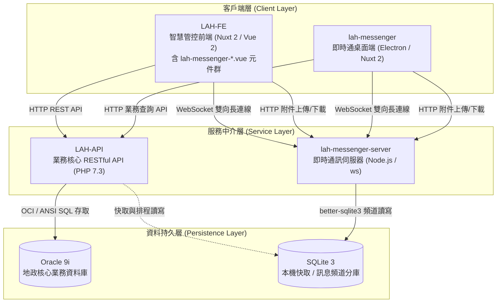

# LAH 系統全域架構契約

> 適用範圍：本工作區根目錄及其五個平級 Git 子專案。  
> 目的：建立 AI Agent（含 Master Agent / Subagents）在跨專案開發、修改程式碼、執行終端指令與驗證時必須遵守的系統邊界與安全規則。

---

## 1. 工作區與系統拓撲

工作區根目錄本身僅管理全域設定與文件，透過 Junction 整合五個獨立子專案容器：

| 目錄 | 系統角色 | 核心技術與版本 | 主要職責 |
|---|---|---|---|
| `./LAH-API/` | API 伺服器／後端核心 | PHP 7.3.x、Legacy HTML、Oracle 9i、SQLite 3 | 提供 HTTP REST API、維護舊版網頁，並存取 Oracle 與 SQLite |
| `./LAH-FE/` | 智慧管控系統前端 | Nuxt 2.15.8 (Vue 2)、BootstrapVue 2.23.0 | 提供智慧監控管理介面，並內嵌即時通功能（移植元件群 `lah-messenger-*.vue`）；透過 HTTP 呼叫 `LAH-API`，並透過 WebSocket/HTTP 與 `lah-messenger-server` 進行即時通訊 |
| `./lah-messenger-server/` | 即時通伺服器 | Node.js (CommonJS)、ws ^7.4.6、Express ^4 | 維持 WebSocket 長連線、處理即時事件與附件，並存取 SQLite |
| `./lah-messenger/` | 桃園即時通桌面客戶端 | Electron 39.8.10、Nuxt 2.15.8、Nuxtron ^0.3.1 | 透過 HTTP 呼叫 `LAH-API` 處理業務功能，透過 WebSocket 連線即時通伺服器 |
| `./LAH-Updater/` | 系統自動更新部署工具 | Python 3.10+ 標準庫 (`tkinter`)、PyInstaller | 供各地政事務所管理師讀取更新壓縮包 (`.zip`) 自動對齊解壓覆蓋，並控制 Apache 與 PM2 服務重啟 |

### 1.1 資料流向與架構拓撲



> **說明**：  
> 1. `LAH-API` 作為後端核心資料樞紐，唯一負責對接 `Oracle 9i`。  
> 2. `lah-messenger-server` 專注於 WebSocket 高併發雙向推播與附件處理，資料庫層採獨立 SQLite 頻道分庫架構。  
> 3. `LAH-FE` 亦移植整合了 `lah-messenger` 即時通功能（`components/lah-messenger-*.vue` 元件群），與 `lah-messenger` 桌面端同樣透過 WebSocket 及 HTTP 與 `lah-messenger-server` 保持通訊。  
> 4. `LAH-FE` 與 `lah-messenger` 桌面端一律透過標準協定呼叫對應伺服器，嚴格禁止直接穿透存取資料庫。  
> 5. `LAH-Updater` 為獨立維運部署工具，負責將打包後之 `www.zip` (後端 PHP7)、`LAH-API.zip` (後端 PHP8)、`LAH-NUXTJS.zip` (前端網站)、`LAH-NUXTJS-node_modules.zip` (前端核心套件)、`lah-messenger-server.zip` (即時通伺服端)、`lah-messenger-server-node_modules.zip` (即時通核心套件) 與 `node.zip` (Node.js 綠色環境) 部署至目標伺服器並協助重啟 Apache 及 PM2 服務。

### 1.2 系統邊界

- `LAH-FE` 不得直接存取 Oracle 或 SQLite。
- `LAH-FE` 不得繞過 `LAH-API` 直接處理後端資料庫業務。
- `LAH-FE` 與 `lah-messenger` 的地政業務 API 呼叫一律透過 `LAH-API`。
- `LAH-FE`（含 `lah-messenger-*.vue` 元件）與 `lah-messenger` 的即時事件與訊息，應透過 `lah-messenger-server` 的 WebSocket 連線處理，附件則透過其 HTTP 端口處理。
- `LAH-API` 是 HTTP 業務 API 的主要資料樞紐。
- `lah-messenger-server` 是 WebSocket 即時通訊與附件處理的主要服務端。
- 不得因單一功能需求任意改變上述架構邊界。

### 1.3 工作區快捷腳本與子專案規格速查

#### 工作區本機開發快捷腳本（根目錄）
- **一鍵啟動**：雙擊或終端執行 [start_dev.bat](file:///c:/Temp/workspace-lah/start_dev.bat)（自動於獨立視窗啟動 `LAH-API`、`LAH-FE`、`lah-messenger-server` 並支援自動開啟瀏覽器 `http://127.0.0.1:8080`）。
- **一鍵關閉**：雙擊或終端執行 [stop_dev.bat](file:///c:/Temp/workspace-lah/stop_dev.bat)（安全釋放 Port 80, 8080, 8081, 8082 占用之服務進程）。
- **一鍵更新**：雙擊或終端執行 [git-pull.bat](file:///c:/Temp/workspace-lah/git-pull.bat)（自動針對根目錄及底下所有 Git 子專案目錄依序執行 `git pull` 同步最新程式碼）。

#### 1. `./LAH-API/` (後端 RESTful API 核心)
- **環境與主要依賴**：
  - Runtime：`PHP 7.3.x`（嚴禁使用 PHP 7.4+ / 8.x 新語法）
  - 資料庫：`Oracle 9i`（主要）、`SQLite 3`（本機/快取）
  - 套件依賴（`www/composer.json`）：
    - `phpoffice/phpspreadsheet`: `^1.14`
    - `php-imap/php-imap`: `4.5.3`
- **常用測試與維護指令**：
  - 語法檢查：`php -l <file_path>`（例如 `php -l www/class/System.class.php`）
  - 安裝依賴：`composer install`（位於 `LAH-API/www` 目錄，執行前需授權）
  - 排程執行驗證：`php www/task/watchdog.php`

#### 2. `./LAH-FE/` (智慧管控系統前端)
- **環境與主要依賴**（`package.json`）：
  - 核心框架：`Nuxt.js 2.15.8`（基於 `Vue 2.x`，預設採 Options API）
  - UI 框架：`BootstrapVue 2.23.0`（配合 `bootstrap ^4.5.2`）
  - 圖表與資料：`chart.js 3.9.1`、`vue-chartjs ^4.0.3`、`better-sqlite3 8.5.0`
- **模組架構特點**：
  - 內建移植自即時通之完整元件群（`components/lah-messenger-*.vue`，包含側邊欄、聊天室看板、公告卡片、訊息輸入與附件上傳等）。
  - 前端同時對接 `LAH-API`（業務 REST API）與 `lah-messenger-server`（WebSocket 長連線 :8081 與附件 HTTP 服務 :8082）。
- **常用測試與打包指令**：
  - 開發伺服器：`yarn dev` 或 `npm run dev`（執行 `nuxt`）
  - 程式碼檢查與修復：`yarn lint` 或 `npm run lint`（執行 `eslint --fix --ext .js,.vue --ignore-path .gitignore .`）
  - 正式環境建置：`yarn build` 或 `npm run build`（執行 `nuxt build`）
  - 靜態站點產出：`yarn generate` 或 `npm run generate`（執行 `nuxt generate`）
  - 生產伺服器啟動：`yarn start` 或 `npm run start`（執行 `nuxt start`）
  - 本地排程服務：`yarn scheduler` 或 `yarn scheduler-dev`

#### 3. `./lah-messenger-server/` (即時通 WebSocket 伺服器)
- **環境與主要依賴**（`package.json`）：
  - Runtime：`Node.js`（CommonJS 模組化）
  - 通訊與 Web 引擎：`ws ^7.4.6`、`express ^4`
  - 資料庫引擎：`better-sqlite3 ^8.5.0`、`sqlite3 ^4.2.0`（頻道分庫架構 `db/<channel>.db`）
  - 附件與內容處理：`multer 1.4.4-lts.1`、`marked ^4.0.10`、`dompurify ^2.3.3`
- **常用測試與維護指令**：
  - 開發熱重載啟動：`npm run dev`（執行 `nodemon server.js`）
  - 常規啟動：`npm start`（執行 `node server.js`）
  - 語法檢查：`node -c <file_path>`（修改後必須執行語法檢查以防產線重啟失敗）

#### 4. `./lah-messenger/` (桃園即時通桌面客戶端)
- **環境與主要依賴**（`package.json`）：
  - 桌面主框架：`Electron 39.8.10`
  - 整合與打包工具：`nuxtron ^0.3.1`、`electron-builder ^22.14.13`
  - Renderer 渲染端：`Nuxt.js ^2.15.8`（基於 `Vue 2.x`）
  - UI 框架：`BootstrapVue ^2.18.1`（配合 `bootstrap ^4.5.2`）
- **常用開發與打包指令**：
  - 開發模式（Electron + Nuxt 熱重載）：`npm run dev`（執行 `nuxtron`）
  - 原生依賴安裝：`npm run postinstall`（執行 `electron-builder install-app-deps`）
  - 標準應用建置：`npm run build`（執行 `nuxtron build`，打包前需確認授權）
  - Windows 全架構安裝包建置：`npm run build:win`（執行 `nuxtron build --win --ia32 --x64`）
  - Windows 32 位元安裝包建置：`npm run build:x86`（執行 `nuxtron build --win --ia32`）
  - Windows 64 位元安裝包建置：`npm run build:x64`（執行 `nuxtron build --win --x64`）

#### 5. `./LAH-Updater/` (系統自動更新部署工具)
- **環境與主要依賴**：
  - Runtime：`Python 3.10+`（嚴格僅使用 Python 標準庫 `tkinter`, `ttk`, `zipfile`, `subprocess`, `threading`, `ctypes` 等，零外部執行期依賴）
  - 打包工具：`PyInstaller`（僅開發期編譯單一 `.exe` 使用）
- **常用測試與打包指令**：
  - 語法檢查：`python -m py_compile updater.py`
  - 直接啟動 GUI：`python updater.py`
  - 單一執行檔打包（需人工確認）：`pyinstaller --noconfirm --onefile --windowed --uac-admin --name "智慧控管與監控系統 - 自動更新工具" updater.py`

---

## 2. 跨專案介面契約

凡涉及兩個以上子專案的需求，必須先識別受影響的介面，再進行修改。

### 2.1 HTTP API：LAH-API ↔ LAH-FE / lah-messenger

修改 `LAH-API` 的下列內容時，必須搜尋所有呼叫端：

- API 路由
- HTTP Method
- Request 參數名稱或型別
- Request Body
- Response JSON 結構
- 欄位名稱
- 欄位型別
- 錯誤碼或錯誤格式
- 驗證與授權行為

至少檢查：

- `./LAH-FE/`
- `./lah-messenger/`
- `./LAH-API/` 內部的 Legacy HTML 頁面

修改呼叫端時，也必須確認目前 API 契約仍然相容。

**原則：除非明確要求，不得任意修改既有 API 契約。**

### 2.2 WebSocket 與附件協定：lah-messenger-server ↔ lah-messenger / LAH-FE

修改以下內容時，必須同步檢查伺服器與客戶端：

- Event Name / Command
- Payload 結構
- 欄位名稱與型別
- 連線／斷線行為
- 錯誤事件
- 廣播與指定客戶端推播邏輯
- 附件上傳、下載與刪除之 HTTP API 路由與 Multipart 格式

檢查範圍必須同時包含：
- `./lah-messenger/`（Electron Main Process 與 Renderer Process）
- `./LAH-FE/`（`components/lah-messenger-*.vue` 系列元件與相關 store/mixin）

### 2.3 SQLite：LAH-API ↔ lah-messenger-server

兩個專案可能共同存取 SQLite。

修改：

- Schema
- Table
- Column
- Index
- Transaction
- SQL 查詢
- 寫入／更新／刪除邏輯

時，必須檢查兩端的讀寫相容性。

特別注意：

- Database Lock
- Busy Timeout
- Transaction 邊界
- 並行讀寫
- Migration 相容性
- 舊資料相容性

**原則：Schema 變更不得只修改其中一端。**

---

## 3. 資料庫規範與安全護欄

本系統使用 Oracle 與 SQLite。Agent 必須明確區分兩者 SQL 方言，不得混用。

### 3.1 Oracle

Oracle 主要由 `./LAH-API/` 存取。

撰寫或修改 Oracle SQL 時：

- 不得使用 MySQL／SQLite 專屬語法。
- 不得使用反引號 `` ` ``。
- 日期處理應依現有專案慣例使用 `TO_DATE`、`TO_CHAR` 等 Oracle 語法。
- 分頁應依實際 Oracle 版本與既有程式慣例處理。
- 必須注意 Oracle 欄位名稱、資料型別及 NULL 行為。

#### Oracle 資安紅線

Agent **不得自動執行**下列正式或測試環境資料庫破壞性操作：

- `DROP`
- `TRUNCATE`
- `ALTER`
- 未帶適當 `WHERE` 條件的 `DELETE`
- 未帶適當 `WHERE` 條件的 `UPDATE`

需要 Schema 變更時：

1. 產出 SQL 腳本。
2. 明確說明影響範圍。
3. 交由人工審核。
4. 未取得明確授權前不得直接執行。

### 3.2 SQLite

SQLite 主要由：

- `./LAH-API/`
- `./lah-messenger-server/`

存取。

規則：

- 本機測試應使用專用測試資料庫，例如 `test.sqlite`。
- 不得為測試而清空或覆寫既有開發資料庫。
- Schema 修改必須檢查 PHP 與 Node.js 兩端。
- 涉及多程序同時讀寫時，必須注意 SQLite Lock、Busy Timeout 與 Transaction。

---

## 4. Git 與工作區規則

### 4.1 獨立 Git Repository

工作區根目錄與五個子專案各自獨立版控（根目錄透過 `.gitignore` 排除所有子專案 Junction，僅管理根目錄設定檔與文件）：

```text
workspace/                   # Git Repo (僅管理根目錄設定檔與文件)
├── LAH-API/                 # 獨立 Git Repo (Junction 連結)
├── LAH-FE/                  # 獨立 Git Repo (Junction 連結)
├── lah-messenger-server/    # 獨立 Git Repo (Junction 連結)
├── lah-messenger/           # 獨立 Git Repo (Junction 連結)
└── LAH-Updater/             # 獨立 Git Repo (Junction 連結)
```

執行任何 Git 指令前，必須確認目前位於正確的儲存庫目錄（根目錄或各子專案目錄）。

例如：

```powershell
cd .\LAH-API
git status
```

或：

```powershell
cd .\LAH-FE
git diff
```

不得將不同儲存庫的變更視為單一 Git Repository 的變更。

### 4.2 跨專案修改

若一次需求修改多個 Repository：

1. 分別確認各 Repository 的目前狀態。
2. 分別修改。
3. 分別執行測試與驗證。
4. 最後進行跨專案介面相容性檢查。
5. 產出各 Repository 的變更摘要。

### 4.3 提交與推送規範 (Commit & Push)

當使用者指示或需要將變更推送到 Git 遠端儲存庫時，Agent 必須遵守以下流程與格式：

1. **先提交再推送**：嚴格依循「檢查狀態 (`git status`/`git diff`) → 暫存變更 (`git add`) → 撰寫詳細繁體中文資訊並提交 (`git commit`) → 推送至遠端 (`git push`)」，嚴禁未提交便推送或省略變更說明。
2. **Commit 訊息語言**：**一律使用台灣繁體中文**撰寫詳細修改資訊。
3. **Commit 訊息結構**：
   - **標題行（Summary）**：採用 Conventional Commits 前綴（如 `feat:`, `fix:`, `docs:`, `chore:`, `refactor:`）搭配簡明繁體中文摘要。
   - **詳細說明（Body）**：空一行後，必須詳列具體修改資訊，包含：
     - 修改目的與背景。
     - 具體修改項目與檔案清單。
     - 介面相容性或影響範圍說明。
   - **格式範例**：
     ```text
     feat: 新增使用者登入逾時自動重新整理功能

     - 修改目的：避免逾時後未更新 Token 導致 API 回傳 401 錯誤。
     - 修改項目：
       - components/lah-login.vue: 加入 15 分鐘計時器並提示倒數通知。
       - store/auth.js: 新增 refreshToken action 與狀態管理。
     - 相容性說明：與既有 LAH-API 驗證端點相容，不影響現行登入介面。
     ```

---

## 5. Agent 調度規則

### 5.1 單一專案任務

若需求只涉及一個 Repository：

- 優先限制 Agent 的修改範圍於該 Repository。
- 不得無必要地修改其他專案。

### 5.2 跨專案任務

若需求涉及多個 Repository：

- Master Agent 負責確認整體需求、介面契約與最終整合。
- Subagent 優先各自鎖定單一 Repository。
- 各 Subagent 完成後，由 Master Agent 檢查跨專案相容性。
- 不得因分工而省略 API、WebSocket 或 SQLite 的跨端檢查。

### 5.3 合作開發環境規範（強制 LAH-API MOCK 模式）

使用 Agent 進行協同開發、除錯、測試或跨專案介面驗證時：

- **`LAH-API` 必須強制處於 MOCK 模式**：
  - 設定方式：確認或在 `./LAH-API/www/.env` 檔案中加入或設為 `MOCK=true`。
- **安全防護目的**：
  - 避免 Agent 在開發與自動化執行時對外部正式／測試環境 Oracle 9i 資料庫產生不必要的連線、逾時或意外破壞。
  - 提供前端（`LAH-FE` 與 `lah-messenger`）穩定預期的 Mock 快取資料以驗證業務介面與資料格式。
- **操作約束**：
  - 未經人工明確授權，Agent 嚴禁擅自將 `MOCK` 關閉（改為 `false` 或 `0`）。

---

## 6. 終端指令與人工授權

### 6.1 可自動執行

在不修改外部環境、不破壞資料的前提下，可自動執行：

- 唯讀搜尋
- `git status`
- `git diff`
- 程式碼語法檢查（如 `php -l`、`node -c`、`python -m py_compile`）
- Lint 檢查（如 `yarn lint` / `npm run lint`）
- 型別檢查
- 單元測試
- Dry-run
- 建置檢查（不發布、不覆蓋正式產物）

### 6.2 原則上需人工確認

下列操作執行前應取得人工明確授權：

- `npm install`
- `npm uninstall`
- `composer require`
- `composer remove`
- 修改 `.env`
- 修改正式環境設定
- 建立或修改資料庫 Schema
- 連線至正式／測試資料庫執行寫入
- `electron-builder` / `nuxtron build` / `pyinstaller`（產出正式安裝套件或打包）
- 發布或部署
- 任何可能覆寫既有資料或環境的操作

若工具環境已提供明確的授權機制，應遵循該機制，不得自行假設已取得授權。

---

## 7. 程式碼修改原則

### 7.1 最小必要變更

除非需求明確要求重構，Agent 應遵循：

- Minimal Change
- Minimal Diff
- Preserve Existing Behavior
- Backward Compatibility

不得為了「順便整理」而大量重構無關程式碼。

### 7.2 既有介面優先

修改程式碼時應優先保留：

- 既有 API
- 既有資料格式
- 既有 Event Name
- 既有資料庫 Schema
- 既有函式／類別／變數命名
- 既有使用方式

若確實需要破壞性變更，必須明確指出：

1. 破壞了什麼。
2. 為什麼需要。
3. 哪些專案受到影響。
4. 如何完成相容性更新。

### 7.3 不猜測既有行為

遇到不確定的程式行為時：

1. 先搜尋實際程式碼。
2. 檢查呼叫端與被呼叫端。
3. 檢查設定檔與 Package 定義。
4. 再提出修改方案。

不得以「通常應該如此」取代對既有程式碼的確認。

---

## 8. 變更前檢查

涉及程式碼修改時，Agent 應依序確認：

1. 目前 Repository。
2. Git 工作區是否已有使用者變更。
3. 需求涉及哪些檔案。
4. 是否存在跨專案依賴。
5. 是否涉及 API / WebSocket / SQLite 契約。
6. 是否涉及資料庫或外部環境。
7. 是否有更上層或子目錄的 `AGENTS.md` 規則。

**既有使用者修改不得未經確認而覆蓋、還原或刪除。**

---

## 9. 驗證規則

完成修改後，至少應進行與變更範圍相符的驗證：

### 單一專案

- 檢查語法。
- 執行適用的 Lint / Type Check / Unit Test。
- 檢查 Git Diff。
- 確認沒有產生非預期檔案。

### 跨專案

除上述項目外，必須確認：

- HTTP API Request / Response 相容。
- WebSocket Event / Payload 與附件協定相容（需同步確認 `lah-messenger` 與 `LAH-FE` 移植之 `lah-messenger-*.vue` 元件群）。
- SQLite Schema 與讀寫邏輯相容。
- Legacy HTML 頁面未受到非預期影響。
- Electron Main / Renderer 的介面仍然一致。

無法實際執行某項驗證時，必須明確標示「未驗證」，不得宣稱已通過。

---

## 10. 產出與溝通規範

### 10.1 語言

Agent 的：

- 執行報告
- 變更摘要
- Commit 訊息建議
- PR 描述
- 技術說明

原則上使用**台灣繁體中文**及台灣慣用資訊術語，例如：

- 專案
- 伺服器
- 資料庫
- 陣列
- 物件
- 非同步
- 呼叫
- 程式碼
- 套件
- 部署

程式碼中的既有英文命名不得為了中文化而任意修改。

### 10.2 跨專案變更摘要

完成跨專案任務後，必須提供：

| 儲存庫 | 修改檔案 | 主要變更 | 介面相容性 |
|---|---|---|---|
| `LAH-API` | `path/to/file` | 說明 | 已確認／未確認 |
| `LAH-FE` | `path/to/file` | 說明 | 已確認／未確認 |
| `lah-messenger-server` | `path/to/file` | 說明 | 已確認／未確認 |
| `lah-messenger` | `path/to/file` | 說明 | 已確認／未確認 |
| `LAH-Updater` | `path/to/file` | 說明 | 已確認／未確認 |

若某 Repository 未修改，可省略該列。

---

## 11. 規則優先順序

當不同層級的 Agent 規則發生衝突時，應依實際 Agent 平台的規則載入順序處理，並遵循較具體範圍的規則。

建議規則層級：

```text
工作區根目錄 AGENTS.md
        │
        ├── LAH-API/AGENTS.md
        ├── LAH-FE/AGENTS.md
        ├── lah-messenger-server/AGENTS.md
        ├── lah-messenger/AGENTS.md
        └── LAH-Updater/AGENTS.md
```

- 根目錄 `AGENTS.md`：定義跨專案架構、資料邊界、安全與協作規則。
- 子專案 `AGENTS.md`：定義該專案的技術棧、程式碼風格、測試及專案專屬規則。
- 子專案規則不得無故違反根目錄所定義的安全紅線與跨專案架構邊界。

---

## 12. Agent 執行前快速檢查清單

開始修改前：

- [ ] 確認目前 Repository。
- [ ] 讀取適用的 `AGENTS.md`。
- [ ] 確認 Git 工作區既有變更。
- [ ] 確認 LAH-API 處於 MOCK 模式（檢查 `./LAH-API/www/.env` 中 `MOCK=true`）。
- [ ] 判斷是否涉及其他 Repository。
- [ ] 判斷是否涉及 HTTP API。
- [ ] 判斷是否涉及 WebSocket。
- [ ] 判斷是否涉及 SQLite Schema / SQL。
- [ ] 判斷是否涉及 Oracle。
- [ ] 判斷是否需要人工授權。
- [ ] 採用最小必要變更。

完成修改後：

- [ ] 檢查 Git Diff。
- [ ] 執行適用的語法／Lint／測試。
- [ ] 確認沒有覆蓋使用者既有修改。
- [ ] 跨專案介面已完成相容性檢查。
- [ ] 未執行未授權的破壞性操作。
- [ ] 清楚列出修改檔案與驗證結果。
- [ ] 若需推送至 Git：嚴格依循以繁體中文撰寫詳細修改資訊（目的、修改項目清單、相容性說明）後提交再推送。

---

## 13. 工作區內建工程技能庫（`.agents/skills/`）

本工作區於 [`.agents/skills/`](./.agents/skills/README.md) 內建移植自 **pstack** 的 54 個工程技能（Skills），已全數轉為**台灣繁體中文**並適配 Antigravity 與本專案架構契約。

### 13.1 核心技能與使用方式

- **總路由技能 [`poteto-mode`](./.agents/skills/poteto-mode/SKILL.md)**：處理複雜功能開發、跨專案修改、臭蟲根因追查、效能調校與重構時的核心入口（內含 23 個劇本 Playbooks 與 24 項工程原則 `principle-*`）。
- **常用獨立技能**：
  - 調查與理解：[`how`](./.agents/skills/how/SKILL.md)（機制解析）、[`why`](./.agents/skills/why/SKILL.md)（歷史與設計原因考證）、[`teach`](./.agents/skills/teach/SKILL.md)（圖解教學）、[`blast-radius`](./.agents/skills/blast-radius/SKILL.md)（變更爆炸半徑與跨專案影響分析）。
  - 設計與平行探索：[`architect`](./.agents/skills/architect/SKILL.md)（跨邊界介面設計）、[`arena`](./.agents/skills/arena/SKILL.md)（多方案平行實作比較）、[`swarm`](./.agents/skills/swarm/SKILL.md)（平行切片檢查與彙整）。
  - 品質、驗證與寫作：[`interrogate`](./.agents/skills/interrogate/SKILL.md)（對抗式程式碼審查）、[`tdd`](./.agents/skills/tdd/SKILL.md)（測試驅動修復）、[`unslop`](./.agents/skills/unslop/SKILL.md)（去除 AI 贅字與生硬句型）、[`technical-writing`](./.agents/skills/technical-writing/SKILL.md)（技術文件與繁中 Commit 撰寫標準）、[`poteto-help`](./.agents/skills/poteto-help/SKILL.md)（技能選擇指南）。
- 完整技能清單、23 個劇本與 24 項工程原則請參閱 [`.agents/skills/README.md`](./.agents/skills/README.md)。

### 13.2 技能執行與強制繁體中文輸出約束

1. **強制台灣繁體中文輸出**：觸發 `.agents/skills/` 內任何技能、劇本或派遣子代理（`invoke_subagent`）時，所有對使用者的回覆、調查報告、架構提案、待辦清單、決策紀錄（TSV）、PR 描述與 Commit 訊息，**一律強制使用台灣繁體中文輸出**。
2. **本契約優先原則**：所有技能執行時均受本 `AGENTS.md` 第 1–12 節約束（包含 `LAH-API` 強制 `MOCK=true`、Oracle 資安紅線、保留與修改無關之既有程式碼註解與 Docstring、以及五個子專案獨立 Git 版控規範）。

### 13.3 常用組合工作流規範（`/grill-me` + `/poteto-mode`）

當使用者同時觸發 `/grill-me` 與 `/poteto-mode`（或要求在動工前進行嚴格架構對齊與防呆質詢）時，Agent 必須遵循以下協同規範：

1. **角色與態度（Candor over Sycophancy）**：
   - 扮演直白、嚴謹且拒絕盲從的資深系統架構師（遵循 `poteto-mode` 的「No is an acceptable answer」原則）。若使用者的初步構想存在架構破口或違反 `AGENTS.md` 邊界，必須第一時間直接點破並提出替代方案。
2. **先查證事實，再質詢決策（Evidence before Questions）**：
   - 凡可透過讀取程式碼確認的客觀事實（既有欄位、函式簽章、呼叫端位置），Agent 必須先自行查明，**嚴禁將查得到的程式碼事實丟回給使用者回答**。
   - 僅針對「架構設計取捨、邊界條件策略、跨專案相容方案、產品行為偏好」發起質詢。
3. **LAH 系統四大必審雷區**：
   - **Oracle 9i 與 SQL 安全**：空值處理、`IN` 子句限制、ANSI/OCI 語法相容性、無破壞性操作。
   - **SQLite 跨端並行**：`LAH-API` (PHP) 與 `lah-messenger-server` (Node.js) 共同讀寫時的 Busy Timeout、Lock 與 Transaction 邊界。
   - **執行期版本與環境約束**：`LAH-API` 嚴守 PHP 7.3 語法與 `MOCK=true` 防護；前端嚴守 Vue 2 / Nuxt 2 Options API 與回應狀態碼檢查；`LAH-Updater` 嚴守 Python 3.10+ 標準庫零外部依賴。
   - **跨專案介面契約**：HTTP API 回應結構與 WebSocket 事件對 `LAH-FE`、`lah-messenger` 及舊版 HTML 頁面的向下相容性。
4. **互動與輸出格式（`unslop` + `ask_question`）**：
   - **極簡高密度**：套用 [`unslop`](./.agents/skills/unslop/SKILL.md) 規範，禁止客套開場白與長篇空泛理論，每道問題背景控制在 1～3 句話內，直指核心風險。
   - **結構化決策**：使用 Antigravity 的 `ask_question` 工具沿決策樹推進，每個問題皆須提供明確的 `(Recommended)` 推薦選項與理由，待關鍵設計分支全數對齊後再動手實作。
5. **事後死角審查（搭配 [`interrogate`](./.agents/skills/interrogate/SKILL.md)）**：
   - 若使用者於程式碼修改後要求進行嚴苛審查，自動結合 [`interrogate`](./.agents/skills/interrogate/SKILL.md) 技能，僅條列具體邊界漏洞、型別不一致與資安風險，不輸出無關的冗長重構。

