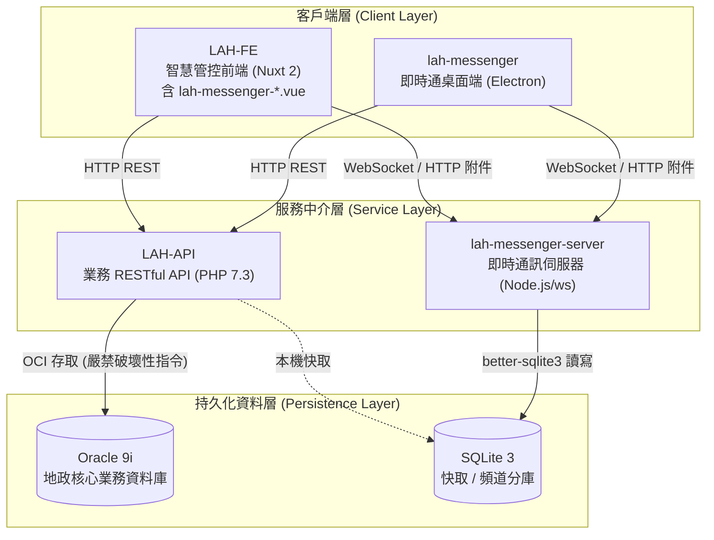
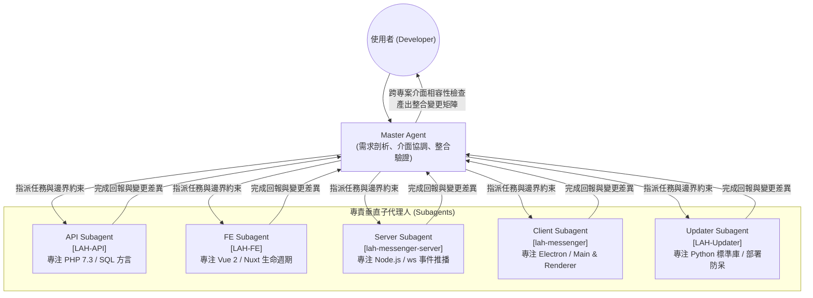
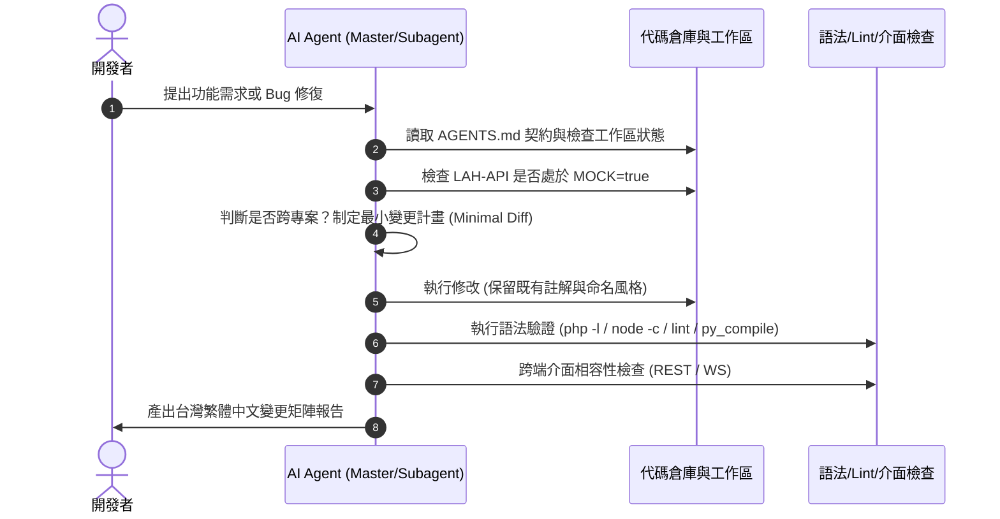

# LAH Workspace（地政整合智慧管控系統工作區）

> 本工作區為多專案容器架構（Multi-repo Container Workspace），整合前後端、WebSocket 伺服器與桌面客戶端。  
> 同時，本儲存庫作為 **Agentic Coding（AI 智慧代理人協同工程）** 的中樞神經，透過形式化全域架構契約與安全護欄，引導 Master Agent 與 Subagents 進行安全、可預期的高品質跨專案協作。

---

## 目錄

- [1. 工作區與系統架構](#1-工作區與系統架構)
- [2. Agentic 協同架構體系](#2-agentic-協同架構體系)
  - [2.1 代理人層級與調度機制 (Master & Subagents)](#21-代理人層級與調度機制-master--subagents)
  - [2.2 規則繼承與邊界契約 (AGENTS.md)](#22-規則繼承與邊界契約-agentsmd)
- [3. Agentic 安全護欄與行為準則 (Guardrails)](#3-agentic-安全護欄與行為準則-guardrails)
  - [3.1 資料庫安全防線與強制 MOCK 模式](#31-資料庫安全防線與強制-mock-模式)
  - [3.2 跨專案介面契約 (API / WebSocket / SQLite)](#32-跨專案介面契約-api--websocket--sqlite)
  - [3.3 終端機指令授權分級](#33-終端機指令授權分級)
- [4. Agentic 開發生命週期與工作流](#4-agentic-開發生命週期與工作流)
- [5. 本機快速上手與快捷指令](#5-本機快速上手與快捷指令)
- [6. 跨儲存庫版控策略](#6-跨儲存庫版控策略)

---

## 1. 工作區與系統架構

工作區根目錄統籌五個平級獨立子專案，以符號連結（Junction）與各自獨立的 Git Repository 運作：

| 子專案目錄 | 角色定位 | 核心技術棧 | 主要功能與職責 |
|---|---|---|---|
| `./LAH-API/` | 後端 RESTful API 核心 | PHP 7.3.x, Oracle 9i, SQLite 3 | 負責地政核心業務資料處理、對接 Oracle 9i，提供標準 HTTP API |
| `./LAH-FE/` | 智慧管控前端應用 | Nuxt.js 2 (Vue 2), BootstrapVue | 智慧監控管理介面，內嵌移植版即時通元件（`lah-messenger-*.vue`） |
| `./lah-messenger-server/` | 即時通訊 WebSocket 伺服器 | Node.js, Express, `ws`, SQLite 3 | 維護高併發長連線推播、頻道分庫（`db/<channel>.db`）、附件儲存 |
| `./lah-messenger/` | 桃園即時通桌面客戶端 | Electron 39, Nuxtron, Vue 2 | 跨平台桌面端即時通訊，對接 API 與即時通伺服器 |
| `./LAH-Updater/` | 系統自動更新部署工具 | Python 3.10+ (`tkinter`), PyInstaller | 提供各地政事務所管理師讀取 `.zip` 更新包自動對齊解壓，並控制 Apache 與 PM2 服務重啟 |

### 資料流與服務拓撲



---

## 2. Agentic 協同架構體系

在面對異質技術棧（PHP + Oracle、Node.js + SQLite、Nuxt 2 前端、Electron 桌面端、Python 部署工具）的龐大系統時，傳統的「單一對話、全域修改」容易引發介面不同步、語法不相容或破壞性資料庫操作。

本工作區導入 **Agentic Engineering 體系**，將 AI 由單純的自動補全工具提升為**具備邊界意識與安全規範的自主代理人**。

### 2.1 代理人層級與調度機制 (Master & Subagents)



1. **Master Agent（架構主控代理）**：
   - 負責接收複雜需求並識別受影響之子專案。
   - 評估是否跨越專案邊界（HTTP API、WebSocket Payload 或 SQLite Schema）。
   - 進行跨端整合驗證，並產出台灣繁體中文之跨專案變更矩陣報告。
2. **Subagents（專責子代理）**：
   - 各自鎖定單一子專案 Repository，嚴禁無故跨庫修改非權責之檔案。
   - 恪守該子專案之特定版本語法規範（如 LAH-API 嚴格鎖定 PHP 7.3.x，禁止 PHP 7.4+/8.x 語法；LAH-Updater 嚴格僅使用 Python 標準庫）。

### 2.2 規則繼承與邊界契約 (`AGENTS.md`)

系統採用分層規則繼承機制：

```text
工作區根目錄 AGENTS.md (全域架構契約、安全防線、跨專案協定)
    ├── LAH-API/AGENTS.md (後端特定規範)
    ├── LAH-FE/AGENTS.md (前端特定規範)
    ├── lah-messenger-server/AGENTS.md (伺服器特定規範)
    ├── lah-messenger/AGENTS.md (桌面客戶端特定規範)
    └── LAH-Updater/AGENTS.md (自動更新部署工具特定規範)
```

- **全域規則具備最高約束力**：子專案規則不得違反根目錄定義之資安紅線與架構邊界。
- 完整契約規範請參閱 [AGENTS.md](./AGENTS.md)。

---

## 3. Agentic 安全護欄與行為準則 (Guardrails)

為確保 AI 代理在自主探索與執行時不會對正式環境造成破壞，本工作區內建嚴格的安全護欄（Guardrails）：

### 3.1 資料庫安全防線與強制 MOCK 模式

- **強制 MOCK 模式**：
  - Agent 在進行開發、除錯或跨端測試時，**必須確保 `./LAH-API/www/.env` 處於 `MOCK=true`**。
  - 未經人工授權，Agent 嚴禁擅自關閉 MOCK 模式，以杜絕誤連正式 Oracle 9i 核心。
- **Oracle 資安紅線**：
  - 嚴格禁止 Agent 自主執行 `DROP`、`TRUNCATE`、`ALTER`，或缺乏條件的 `DELETE` / `UPDATE`。
  - 任何 Schema 異動必須以獨立 SQL 腳本形式呈現，交付人工審查。
- **SQLite 讀寫隔離**：
  - 本機自動測試必須使用獨立測試檔（如 `test.sqlite`），嚴禁清空或覆寫既有開發資料庫。

### 3.2 跨專案介面契約 (API / WebSocket / SQLite)

當 Agent 異動涉及跨專案介面時，觸發雙向聯動檢驗機制：

1. **HTTP RESTful API**：
   - 修改 `LAH-API` 路由、請求參數或 JSON 回傳結構時，必須同步搜尋並檢查 `LAH-FE` 與 `lah-messenger` 之對應呼叫。
2. **WebSocket & 附件協定**：
   - 修改 `lah-messenger-server` 事件名稱、推播 Payload 或附件上傳路由時，必須同時檢查 `lah-messenger`（Electron）與 `LAH-FE`（移植之 `lah-messenger-*.vue` 元件群）。
3. **SQLite 共享資料庫**：
   - 修改 Schema 時，必須確認 PHP 與 Node.js 兩端的讀寫相容性與 Lock / Busy Timeout 處理。

### 3.3 終端機指令授權分級

Agent 在呼叫工具執行命令時遵守最小權限原則：

- **綠燈（自動授權執行）**：
  - 唯讀搜尋、`git status`、`git diff`。
  - 程式碼語法檢查（`php -l`、`node -c`、`python -m py_compile`）。
  - 程式碼風格與靜態分析（`yarn lint` / `npm run lint`）。
  - 單元測試與 Dry-run 執行。
- **紅燈（必須取得人工確認）**：
  - 套件異動（`npm install`、`composer require` 等）。
  - 環境變數修改（`.env`）。
  - 正式建置打包（`nuxtron build`、`electron-builder`、`pyinstaller`）。
  - 涉及資料庫寫入或不可逆的檔案異動。

---

## 4. Agentic 開發生命週期與工作流

AI Agent 執行任務時必須嚴格依循標準化檢核清單：



### 變更矩陣報告格式規範

完成跨專案修改後，Agent 會產出如下結構清晰的驗證表格：

| 儲存庫 | 修改檔案 | 主要變更內容 | 介面相容性檢查 | 驗證方式 |
|---|---|---|---|---|
| `LAH-API` | `www/class/System.class.php` | 調整查詢效能 | 原介面維持向下相容 | `php -l` 語法通過 |
| `LAH-FE` | `components/lah-messenger-chat.vue` | 支援新訊息標記 | 相容 WebSocket 伺服器 | `yarn lint` 通過 |

---

## 5. 本機快速上手與快捷指令

根目錄提供了一鍵化開發流程腳本：

### 一鍵啟動所有本機服務
雙擊或終端執行根目錄的 [start_dev.bat](./start_dev.bat)：
```cmd
.\start_dev.bat
```
- 自動在獨立視窗啟動 `LAH-API` (PHP Built-in Server :80)。
- 自動啟動 `lah-messenger-server` (WebSocket :8081 / HTTP :8082)。
- 自動啟動 `LAH-FE` (Nuxt :8080)。
- 自動喚起預設瀏覽器開啟 `http://127.0.0.1:8080`。

### 一鍵終止所有本機服務
雙擊或終端執行根目錄的 [stop_dev.bat](./stop_dev.bat)：
```cmd
.\stop_dev.bat
```
- 安全釋放 Port 80, 8080, 8081, 8082 占用之所有 Node / PHP 背景進程。

### 一鍵更新所有專案程式碼
雙擊或終端執行根目錄的 [git-pull.bat](./git-pull.bat)：
```cmd
.\git-pull.bat
```
- 先確認根目錄本身並執行 `git pull`。
- 依序自動掃描各子專案目錄（`LAH-API`、`LAH-FE`、`lah-messenger-server`、`lah-messenger`、`LAH-Updater`），偵測到 `.git` 儲存庫便自動執行 `git pull` 同步最新變更。

---

## 6. 跨儲存庫版控策略

- **根目錄（本 Repository）**：
  - 專門版控工作區級別之設定檔（`AGENTS.md`、`README.md`、`start_dev.bat`、`stop_dev.bat`、`git-pull.bat`、架構圖）。
  - 透過 `.gitignore` 明確排除五個子專案的 Junction 連結，確保不會將子專案檔案重複納入。
- **子專案（各獨立 Repository）**：
  - 各子專案維持獨立 Git Branch、Commit 與 Remote，由開發者或專責 Subagent 分別進行 Commit 與 Push。
