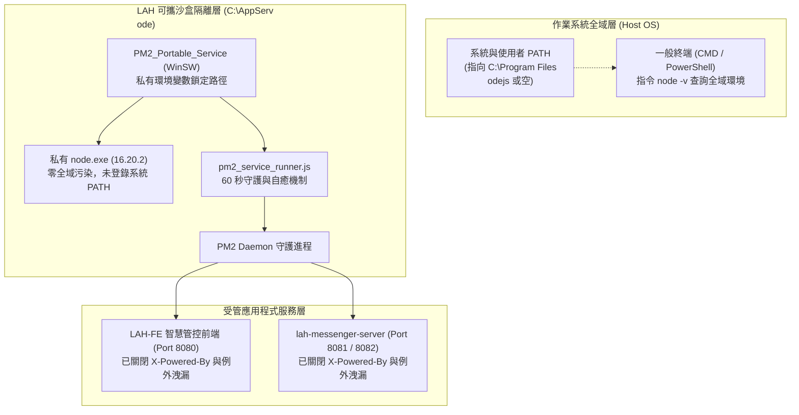

# LAH 系統可攜式 Node.js 沙盒安全規範與資安稽核說明書

> 適用對象：桃園地政各事務所資訊維運同仁、內部資安稽核人員、外部弱點掃描檢測團隊。  
> 目的：說明智慧管控系統（LAH 系統）可攜式 Node.js 執行期環境之沙盒隔離設計、安全邊界防護與稽核白名單報備依據。

---

## 1. 系統拓撲與沙盒架構

本系統前端（`LAH-FE`）與即時通訊服務（`lah-messenger-server`）採用可攜式 Node.js 綠色環境。該環境由 `LAH-Updater/tools/node-portable` 工具統一安裝於主機指定根目錄（預設為 `C:\AppServ\node`）。

---

## 2. 核心資安防護與隔離機制

### 2.1 零全域污染沙盒隔離（Zero Global Pollution）

1. **絕不寫入全域 PATH**：
   安裝時絕不將 `C:\AppServ\node` 登錄至系統（`HKLM`）或使用者（`HKCU`）之 `PATH` 環境變數。
2. **終端隔離驗證**：
   稽核人員於伺服器執行標準 `node -v`，無法調用本可攜環境。若伺服器全域安裝了由 IT 部門升級之 Node.js（如 v22 或 v24），全域僅會顯示該新版資訊，兩者完全物理隔離。
3. **專屬維運終端**：
   系統僅於安裝根目錄產出專屬維運終端 `lah-cmd.bat`。僅在該批次檔開啟之命令視窗內暫時注入私有環境變數，關閉視窗即自動釋放。

### 2.2 全域 Node.js 因資安要求升級時之相容保證

當伺服器因資安要求，日後由 IT 人員以官方 MSI 安裝包升級全域 Node.js（例如於 `C:\Program Files\nodejs` 安裝新版 LTS）時：
- **服務進程硬鎖定**：`PM2_Portable_Service`（WinSW）之設定檔直接指定執行路徑為 `C:\AppServ\node\node.exe`。
- **守護自癒機制**：`pm2_service_runner.js` 每 60 秒檢查 PM2 Daemon 之實體路徑。若偵測被全域非目標 Node.js 搶佔，會自動重啟並切換回沙盒可攜環境。
- **結論**：全域升級 Node.js 完全不影響本系統運作，亦無環境變數覆蓋之風險。

### 2.3 外部網路通訊邊界特徵清洗（HTTP Header Sanitization）

為避免外部黑箱弱點掃描（Blackbox Scanner）透過網路探測識別底層執行期：
1. **全面移除技術棧指紋**：
   - 即時通伺服器（Express）：停用 `X-Powered-By` 標頭（`app.disable('x-powered-by')`）。
   - 智慧管控前端（Nuxt）：透過中介軟體移除 `X-Powered-By`，生產環境關閉 Nuxt 除錯標記。
2. **例外錯誤堆疊隔離**：
   全域未捕捉異常（Unhandled Exceptions）一律由伺服器內部記錄至本機 Log 檔案，嚴禁將呼叫棧（包含內部檔案路徑與 Node.js 執行期資訊）回傳給客戶端。

---

## 3. 資安稽核檢測應對指引（Audit & Compliance）

| 稽核檢測途徑 | 檢測方式 | 系統防護現狀 | 稽核應對說明 |
|---|---|---|---|
| **外部黑箱弱掃** | 透過網路掃描 HTTP Headers、Banner、404/500 錯誤頁 | **完全防禦**：無任何 Node.js、Nuxt 或 Express 指紋洩漏 | 符合資安要求，無弱點。 |
| **一般主機 CLI 檢測** | 登入主機打開 CMD 執行 `node -v` | **完全防禦**：未寫入系統 PATH，無法查得私有版號 | 符合資安要求，無全域衝突。 |
| **特權靜態檔案弱掃** | 弱掃工具以系統管理員憑證掃描硬碟二進位檔案 PE 標頭 | **架構報備**：`node.exe` 檔案屬性標記為 16.20.2 | 依據本說明書進行「專屬應用程式沙盒隔離白名單」報備。 |

### 3.1 針對特權靜態檔案弱掃之官方報備論述

若稽核團隊透過管理員憑證掃描磁碟發現 `C:\AppServ\node\node.exe` 並列出 Node.js 16 EOL 項目，請檢附本說明書與自檢報告，依下列重點提報說明：

1. **封閉沙盒用途**：該執行檔僅限供桃園地政智慧管控系統之專屬內部服務使用，不對外開放通用命令列呼叫。
2. **無外網連線風險**：受管服務皆運行於地政封閉內網（Intranet），不對公網開放。
3. **無全域覆蓋風險**：伺服器可隨時依公務規範於全域安裝最新版 Node.js，本沙盒不會產生任何相依干擾。
4. **長遠技術規劃**：團隊已將底層執行期之升級作業（朝向 Node 20 LTS / 22 LTS）納入中長期維護計畫。

---

## 4. 自動化資安邊界自檢工具

維運人員可隨時執行 `node-portable` 安裝工具：
1. 於主介面點擊「資安邊界自檢」按鈕。
2. 工具將自動探測本機受管服務端口（8080、8081、8082），確認無敏感標頭洩漏。
3. 自檢完成後將自動於 `<根目錄>\logs\security_audit_report.txt` 產出帶有時間戳記與檢驗合格標記之稽核佐證報告。
